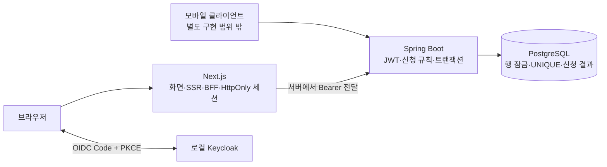

# 다음 모임 — AI와 함께 설계·구현·검증·배포하기

**Next.js + Spring Boot + PostgreSQL**로 만든 스터디 예약 예제입니다. 8명 정원에 7명이 신청한 세션의 마지막 한 자리를 두 사람이 동시에 신청합니다. 중복 클릭, 마감, 응답 유실과 권한 문제까지 같은 예제로 따라갑니다.

**발표할 때는 [큰 글씨 통합 대본](docs/presentation/스터디예약_통합발표대본.docx) 하나를 열어 두세요.** 화면 지시, 열 파일·함수, 그 화면에서 할 말, 확인 질문과 다음 장 연결을 슬라이드별로 묶었습니다. [GitHub에서 같은 대본 읽기](docs/presentation/발표진행대본.md)와 [짧은 진행 큐시트](docs/presenter-guide.md)도 제공합니다. 문법 전체를 암기할 필요는 없지만 정책·경계·검증 근거·권한은 설명할 수 있어야 합니다.

발표용 PPT는 [AWS 확장판 48장](docs/presentation/스터디예약_AWS확장판.pptx)입니다. 기본 42장 뒤에 AWS 범위·기존 EC2 배포와 이 저장소의 배포·로그인·CI 인증·비용 설명 6장이 이어집니다. 통합 대본은 본문 14.5pt, 질문 답변 14pt이며 긴 개념 설명과 96개 Q&A는 같은 문서의 참고편으로 옮겼습니다. [이전 자료](docs/presentation/README.md)도 보존했습니다.

Docker만 준비하면 됩니다. Java·Node·PostgreSQL·로그인 서버를 직접 설치하거나 코드를 고칠 필요가 없습니다. GitHub에서 복제한 폴더의 터미널에서:

```bash
./dev up
```

<http://localhost:3000>을 여세요. 로컬 전용 계정은 `demo-a` 또는 `demo-b`, 비밀번호는 둘 다 `demo-pass-2026`입니다. 실제 OIDC 로그인 화면을 거치며 두 브라우저 프로필로 경쟁을 직접 확인할 수 있습니다. 초기 비밀은 자동 생성해 Git에서 제외한 `.local/`에만 저장합니다.

```bash
./dev verify        # 코드·실제 DB·브라우저·Terraform 검사
./dev status        # 현재 코드에 맞는 검증 결과 확인
./dev down          # 종료, 데이터 보존
```

Windows는 WSL2 터미널과 Docker Desktop을 사용하세요. 처음에는 이미지 다운로드가 필요합니다. 실행 문제는 [확인법과 문제 해결](docs/verification.md)을 보세요.

## 예제의 구조



Next와 Spring이 둘 다 HTTP 서버여도 규칙의 주인은 Spring 하나입니다. Next는 웹 화면과 세션을 담당하고 Spring API는 웹·모바일에서 공유합니다. 3티어는 세 책임 경계이며 프로세스나 서버가 정확히 세 개라는 뜻은 아닙니다.

## 어떤 파일을 보면 되나요?

| 궁금한 것                          | 읽을 곳                                                                                                                                                             |
| ---------------------------------- | ------------------------------------------------------------------------------------------------------------------------------------------------------------------- |
| 인터뷰가 명세·테스트로 바뀌는 과정 | [AI 작업 순서](docs/ai-workflow.md), [신청 정책](docs/registration.md)                                                                                              |
| 실제 화면과 BFF                    | [web/src](web/src), [DESIGN.md](DESIGN.md)                                                                                                                          |
| 정원·재시도·마감·DB 권한           | [RegistrationService](api/src/main/java/dev/study/booking/RegistrationService.java), [실제 PG 테스트](api/src/test/java/dev/study/RegistrationIntegrationTest.java) |
| 스킬·MCP·Stop hook                 | [.agents/skills](.agents/skills), [.codex](.codex), [.claude](.claude), [하네스 설명](docs/ai-workflow.md)                                                          |
| CI와 확인할 결과                   | [verification.md](docs/verification.md), [.github/workflows](.github/workflows)                                                                                     |
| AWS 배포 코드와 실행 순서          | [AWS 가이드](docs/aws.md), [Terraform](infra/aws), [배포 스크립트](scripts/aws)                                                                                     |
| 발표 자료와 같은 코드 찾기         | [슬라이드별 코드 지도](docs/slides-map.json), [PPT·발표 대본](docs/presentation)                                                                                    |

## 코드를 입력하지 않고 시연하기

```bash
./dev demo          # 별도 DB에서 로그인·경쟁·응답 유실·모바일 화면 자동 시연
./dev defect-demo   # 잠금 없는 SQL이 정원을 초과해 테스트에 걸리는 반례
./dev skill-check   # 저장소에 포함한 스킬·설정·출처 검사
./dev mcp-check     # 공개 문서 MCP 응답 확인
./dev infra-check  # AWS 계정 없이 Terraform 검증
```

에이전트에게 줄 인터뷰·구현·리뷰 요청문은 [AI 작업 순서](docs/ai-workflow.md)에 준비되어 있습니다. 새 Codex/Claude 프로젝트 세션에서 `/skills`, `/hooks`, `/mcp`로 실제 발견과 신뢰 상태를 확인합니다. 저장소 파일 검사와 현재 호스트의 활성화는 별개입니다.

## AWS와 GitHub 공유

AWS용 코드는 CloudFront → HTTPS ALB → private Next/Spring ECS Fargate → private RDS 구조입니다. ECR은 이미지 저장소, ECS는 컨테이너 실행·교체·상태 관리를 담당합니다. 동적 웹·인증·신청은 캐시하지 않고 해시가 붙은 `/_next/static/*`만 CloudFront에서 캐시합니다.

로컬 실행과 검증은 AWS 비용 없이 가능합니다. 실제 AWS 배포에는 소유한 도메인·OIDC·AWS 계정과 최초 설정이 필요합니다. [대화형 설정과 배포 가이드](docs/aws.md)를 따라가세요. 이 저장소를 만들었다고 AWS 리소스가 이미 배포되거나 GitHub 필수 검사가 자동 활성화되는 것은 아닙니다.

**현재 실습은 로컬 실행·검증과 AWS 코드의 정적 검사까지입니다.** 실제 AWS 로그인·plan·apply·ECR push·운영 배포는 수행하지 않았습니다. [AWS 로그인과 비용 경계](docs/aws-login.md)에서 `aws login`·조직 SSO·GitHub OIDC의 차이와 어떤 단계부터 자원이 생기는지 확인하세요.

`.local/`, 실제 `.env`, Terraform state/변수, 의존성·빌드 산출물은 공유하지 않습니다. 외부 `frontend-design` 스킬의 라이선스와 고정 출처는 각 스킬 폴더에 포함했습니다. 로컬 데모 계정은 누구나 볼 수 있는 학습용이며 production에 쓰지 않습니다.
ai_dev_example
