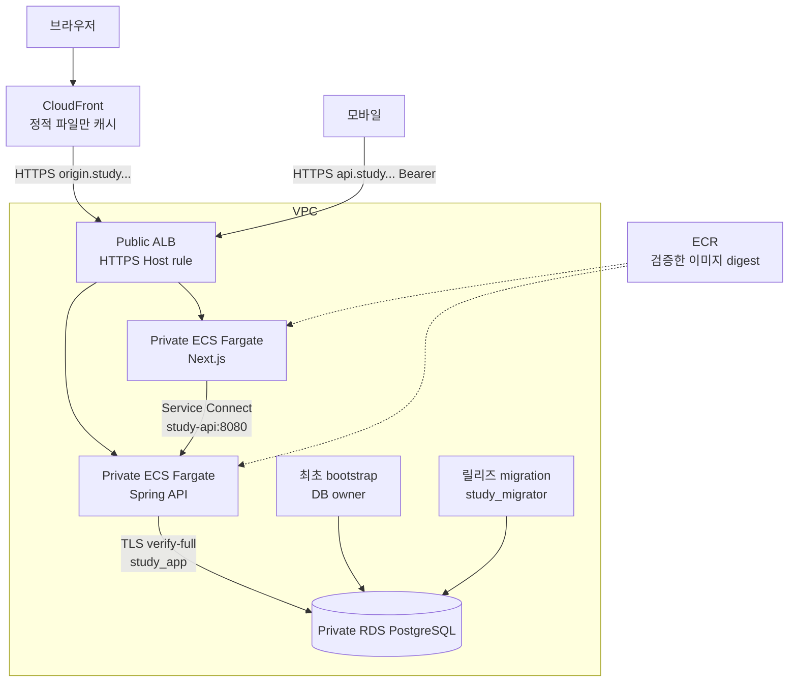

# 같은 예제를 AWS에 배포하기

이 폴더는 **배포할 수 있도록 작성한 코드**이며 실제 AWS apply·계정 연결·DNS 발급은 수행하지 않았다. `./dev infra-check`는 공급자 스키마와 HCL 검증이다. IAM/네트워크/인증서의 실제 계정 동작은 plan 검토와 별도 배포 후 확인한다.

계정 인증과 실행 범위부터 확인하려면 [AWS 로그인·이전/현재 배포 방식·비용 경계](aws-login.md)를 먼저 읽는다. 기본 실습은 로컬에서 끝나며, 이 문서의 apply·push·운영 배포는 미래 운영자의 별도 단계다.



## 처음 한 번 필요한 결정

AWS 리소스는 비용이 발생한다. 이 예제는 학습용 단일 NAT·단일 AZ RDS·서비스당 1개 Task를 기본값으로 쓴다. subnet은 2개 AZ지만 전체가 고가용성인 것은 아니다. 실제 운영에는 요구 SLO에 맞춰 Multi-AZ DB, NAT 이중화, Task 2개 이상, 관측·경보·WAF/요청 제한을 추가한다.

필요한 외부 준비물:

1. 소유한 Route53 hosted zone과 앱 도메인. `origin.<도메인>`과 `api.<도메인>`도 생성한다.
2. production HTTPS OIDC 제공자. callback `https://<앱도메인>/api/auth/callback/keycloak`, confidential client, Authorization Code + PKCE, JWT audience `study-api`, scope `registration:write`, 안정적인 sub를 설정한다. 이 저장소의 로컬 Keycloak은 production으로 올리지 않는다.
3. Terraform 실행용 AWS 운영자 인증과 AWS CLI. 인증 파일을 저장소에 복사하지 않는다. 평소 deploy role은 master DB 비밀을 읽거나 bootstrap task를 실행할 수 없다.
4. 기존 GitHub IAM OIDC provider와 해당 저장소의 정확한 OIDC subject. 신규 저장소는 immutable owner/repository ID가 포함될 수 있으므로 예전 `repo:OWNER/REPO` 형식을 무조건 복사하지 않는다. trust는 production environment의 정확한 sub·aud만 허용한다.

## 1. 코드 수정 없이 입력값 만들기

```bash
./dev aws-configure
```

질문에 답하면 Git에서 제외하는 `infra/aws/local.auto.tfvars`를 만든다. 비밀번호는 묻지 않는다. 이미 있는 설정은 덮어쓰지 않는다. 버전은 Terraform 1.14.0, AWS provider 6.38.0에 고정했다. RDS PostgreSQL 17.9의 대상 지역 제공 여부는 실제 plan/apply 전에 확인하고 필요하면 검토한 minor 버전을 선택한다.

## 2. plan을 확인한 뒤 foundation 생성

아래는 **AWS 리소스 변경을 승인한 운영자가 실행할 명령**이다. Terraform 1.14+와 AWS CLI를 설치한 터미널 기준이다. 로컬 기본 실행에는 필요하지 않다.

```bash
terraform -chdir=infra/aws init
terraform -chdir=infra/aws plan -out=reviewed.tfplan
terraform -chdir=infra/aws apply reviewed.tfplan
mkdir -p .local/aws
terraform -chdir=infra/aws output -json deploy_config > .local/aws/deploy-config.json
```

foundation의 ECS Service는 desired count 0이다. 아직 존재하지 않는 이미지나 DB 스키마로 앱을 먼저 실행하지 않는다. Terraform은 Secret 컨테이너만 만들고 값은 state에 넣지 않는다. master password는 RDS가 관리한다. state도 인프라 정보를 포함하므로 팀 공유 시 암호화·잠금·접근 제어가 있는 backend를 먼저 구성한다. 로컬 state를 Git에 올리지 않는다.

## 3. 비밀 주입과 최초 DB 준비

OIDC 관리자가 준 client secret은 권한이 제한된 임시 파일로 전달한다. 아래 환경변수에는 그 **파일 경로만** 넣는다. 스크립트는 앱 DB·migration DB·세션 비밀을 생성하며 값을 출력하지 않는다. 기존 버전이 있으면 교체를 거절한다. 중간 실패의 재실행은 각 Secret의 버전 metadata를 확인한 뒤 처리한다.

```bash
OIDC_CLIENT_SECRET_FILE=/secure/path/client-secret node scripts/aws/seed-secrets.mjs --confirm-aws-changes
RELEASE_SHA=$(git rev-parse HEAD) node scripts/aws/push-images.mjs
RELEASE_SHA=$(git rev-parse HEAD) node scripts/aws/deploy.mjs --bootstrap-only --confirm-aws-changes
RELEASE_SHA=$(git rev-parse HEAD) node scripts/aws/deploy.mjs --confirm-aws-changes
```

마지막 두 명령은 최초 운영자 인증으로 실행한다. bootstrap은 DB owner로 `study_migrator`와 `study_app`을 만들고 종료한다. migration은 별도 DB 계정으로 Flyway를 실행한다. production migration은 로컬 시연 데이터를 넣지 않는다. 따라서 첫 화면은 빈 세션 목록일 수 있다. 관리 CRUD는 이번 범위 밖이며 실제 세션 생성은 별도 운영 기능으로 설계한다.

첫 푸시/배포 전에는 `./dev verify`가 현재 커밋에서 통과해야 한다. `RELEASE_SHA` 태그는 불변이므로 같은 태그를 다시 push하면 실패한다. 이미지를 재사용하는 재배포는 push를 생략하고 deploy만 실행한다. Apple Silicon에서도 AWS 이미지 빌드는 `linux/amd64`, Task는 X86_64로 맞춘다.

## 4. GitHub의 반복 배포

GitHub에 소스를 공유한 뒤 저장소 Settings에서 직접 설정한다. 이 작업은 아직 자동 수행하지 않았다.

- Actions의 `verification`을 main 병합 필수 검사로 지정한다.
- `production` Environment에 required reviewer를 설정한다. environment를 만든 것만으로 승인자가 자동 지정되지 않는다.
- 해당 Environment variables에 `AWS_DEPLOY_ROLE_ARN`, `AWS_REGION`, Terraform 출력의 비밀 없는 `DEPLOY_CONFIG_JSON`을 넣는다.
- Actions → Deploy AWS → Run workflow. 재검증 → OIDC 단기 인증 → ECR push → migration 종료 0 → API 안정화 → Next 안정화 → 공개 health/API smoke 순서다.

PR 검증에는 AWS 인증이나 production 비밀을 주지 않는다. routine deploy role의 `iam:PassRole`은 api/web/migration에만, `ecs:RunTask`는 migration family와 지정 cluster에만 허용한다. master secret은 bootstrap execution role만 읽는다. 애플리케이션 Task role에는 현재 AWS API 권한이 없다. DB 계정 권한과 IAM 권한은 서로 다른 경계다.

## 캐시·보안·롤백에서 볼 점

CloudFront viewer 인증서는 us-east-1, ALB origin/API 인증서는 앱 지역에 생성한다. `AllViewerExceptHostHeader`는 viewer Host 대신 origin DNS 이름을 ALB로 보낸다. 고정 APP_ORIGIN/NEXTAUTH_URL은 공개 앱 주소다. 쿠키·Origin·POST 등 동적 요청을 전달하며 기본 캐시는 꺼 둔다. `/_next/static/*`만 캐시한다.

ALB origin 주소 자체는 공개되어 있어 CloudFront 우회를 완전히 막는 구성이 아니다. API는 모바일 접근을 위해 공개 Host rule을 갖지만 JWT 검증을 항상 거친다. 운영 요구에 맞춰 origin 인증/WAF/요청 제한을 추가한다. Service Connect 내부 트래픽은 이 예제에서 TLS를 별도 구성하지 않았으며 VPC와 SG 경계를 사용한다. RDS 연결은 CA와 hostname까지 검증하는 TLS다.

`tasks-stopped`는 성공이 아니라 종료다. 스크립트는 컨테이너 exit 0을 확인한다. `services-stable` 뒤에도 기대한 Task revision을 확인해 이전 버전 롤백을 새 버전 성공으로 오인하지 않는다. migration은 Task 롤백으로 되돌아가지 않는다. 새/이전 코드가 함께 동작하는 확장 후 축소 방식의 스키마 변경이 필요하다.

## 공식 자료

- [ECS Service Connect](https://docs.aws.amazon.com/AmazonECS/latest/developerguide/service-connect-concepts-deploy.html)
- [ECS Secret 주입](https://docs.aws.amazon.com/AmazonECS/latest/developerguide/secrets-envvar-secrets-manager.html)
- [RDS master 역할](https://docs.aws.amazon.com/AmazonRDS/latest/UserGuide/Appendix.PostgreSQL.CommonDBATasks.Roles.rds_superuser.html)
- [CloudFront HTTPS 인증서](https://docs.aws.amazon.com/AmazonCloudFront/latest/DeveloperGuide/cnames-and-https-requirements.html)
- [GitHub AWS OIDC](https://docs.github.com/en/actions/how-tos/secure-your-work/security-harden-deployments/oidc-in-aws), [OIDC subject](https://docs.github.com/en/actions/reference/security/oidc)
